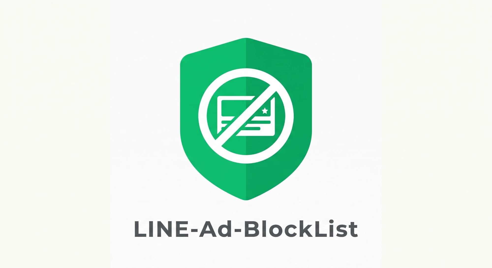
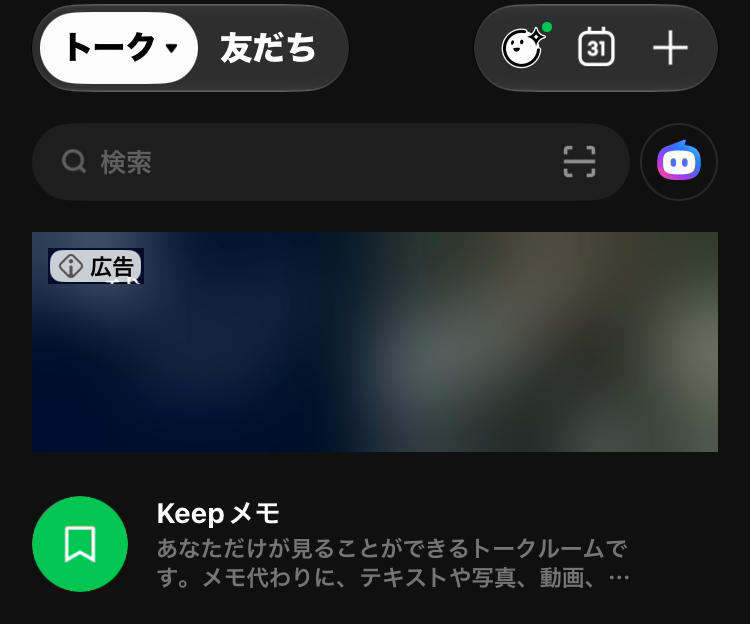
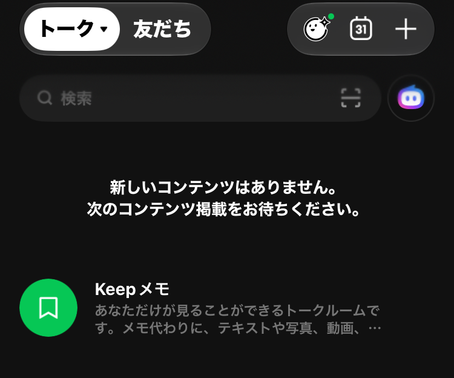
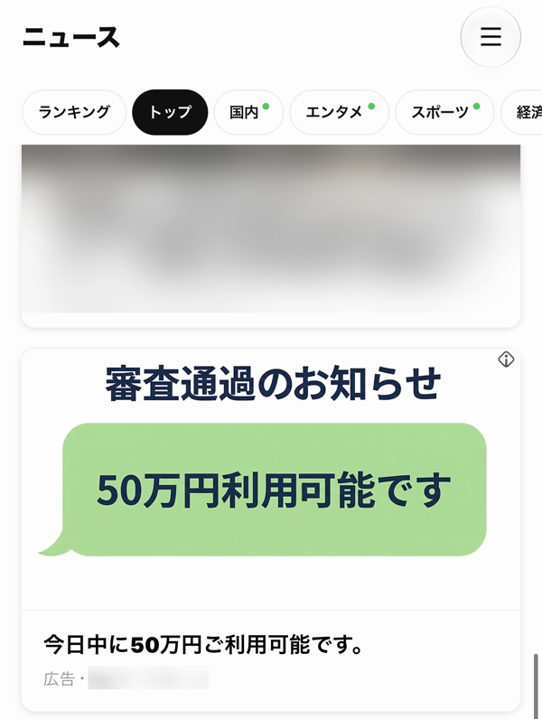
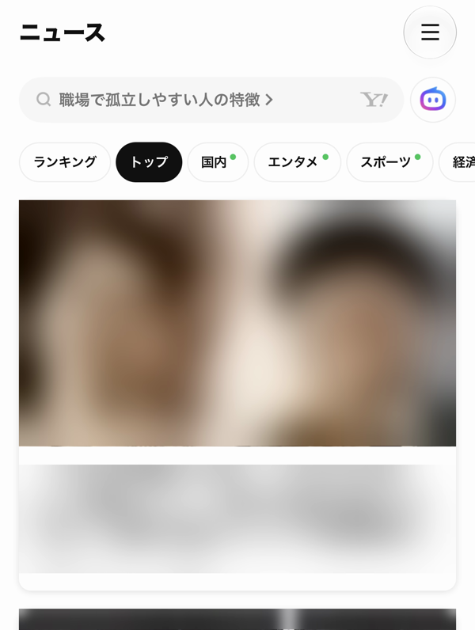
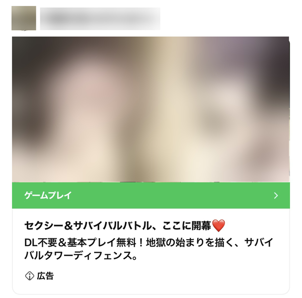
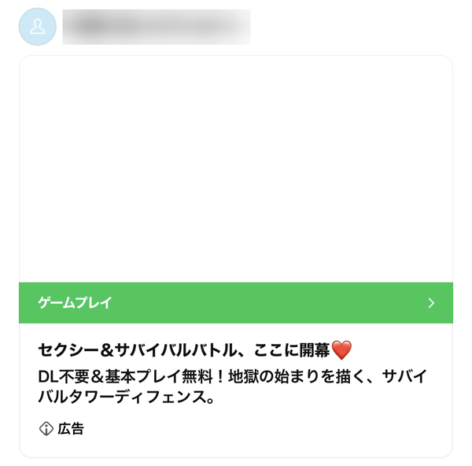

<p align="center">
  
</p>

# LINE-Ad-BlockList

LINEアプリ内の広告（トーク一覧・ニュースタブ・ホームタブ）をブロックするための、DNSブロックリストです。
広告の配信元のドメインをまとめていて、広告ブロックのツールに登録して使います。

| 使えるツール | 使う機能 |
|---|---|
| [AdGuard（iPhoneアプリ）](https://download.adguardcdn.com/d/135962/ios) | DNS保護（有料版の機能） |
| [AdGuard Home](https://adguard.com/en/adguard-home/overview.html) | DNSブロックリスト |

- LINEの機能（トーク、通話、スタンプ、画像の送受信、LINE公式アカウントなど）はそのまま使えます
- ブロックするドメインは必要最低限にしています
- ルールは自動で更新されます。新しい広告の配信元が見つかったら、このリストに追加します（すぐに反映したいときは [ルールの更新](#ルールの更新) を見てください）

## ブロックできるLINEアプリ内の広告

### トーク一覧の上の広告・ニュース

消えます。代わりに「新しいコンテンツはありません。」と表示されます。

| 使う前 | 使った後 |
|---|---|
|  |  |

### ニュースタブの中の広告

枠ごと消えます。

| 使う前 | 使った後 |
|---|---|
|  |  |

### ホームタブ・ミニアプリタブの中の広告

画像は消えますが、広告の枠と文章は残ります。広告の枠は、LINE本体の通信と一緒に届くため消せません。

| 使う前 | 使った後 |
|---|---|
|  |  |

画像の中の広告やニュースの写真は、ぼかしています。

## 使い方（iPhone）

### 1. AdGuardアプリを入れる

1. [AdGuard](https://download.adguardcdn.com/d/135962/ios) をインストールします
2. アプリを開き、案内に沿って初期設定をします

このリストは、AdGuardの **DNS保護** の機能を使います。DNS保護は有料版（AdGuard Pro／プレミアム）の機能です。購入方法はアプリ内の案内に従ってください。

### 2. DNS保護をオンにする

1. AdGuardアプリ下の **盾のマーク（保護）** を開きます
2. **DNS保護** をオンにします
3. 「VPN構成の追加」の確認が出たら、**許可** を選びます
   - iPhoneの中だけで動く仕組みで、通信が外部のVPNサーバーを通るわけではありません

### 3. このリストを登録する

1. **DNS保護** → **DNSフィルタリング** → **DNSフィルタ** を開きます
2. **フィルタを追加** をタップします
3. 次のURLを貼り付けて、追加します

```
https://raw.githubusercontent.com/minimal-enginner/LINE-Ad-BlockList/main/LINE-Ad-BlockList.txt
```

4. 一覧に「LINE-Ad-BlockList」が表示され、オンになっていれば完了です

アプリのバージョンによって、ボタンの名前や場所が少し違うことがあります。

### 4. LINEを開き直す

1. LINEのキャッシュを削除します（LINEの **設定 → トーク → データの削除** で「キャッシュ」を選ぶ）
   - トークの履歴や写真は消えません。念のため、画面の説明を確認してから実行してください
2. LINEを完全に終了してから、もう一度開きます

トーク一覧の上の広告が消えていれば成功です。

## ルールの更新

ルールは基本的に自動で更新されます。ただし、更新されるタイミングは使っているアプリや環境によって違います。新しいルールをすぐに反映したいときは、手動で更新してください。

- **AdGuard（iPhoneアプリ）**：アプリのホーム画面にある更新ボタンをタップします
- **AdGuard Home**：管理画面の **フィルタ → DNSブロックリスト** で **更新を確認** をクリックします

更新したあとは、LINEを完全に終了してから開き直してください。

## よくある質問

**Q. 広告が消えません**\
A. 次を確認してください。

- **AdGuardのDNS保護がオンになっているか** 確認してください
- **Wi-Fiアシストをオフにしてください**（iPhoneの **設定 → モバイル通信 → Wi-Fiアシスト**）
  - オンのままだと、Wi-Fiの電波が弱いときに自動でモバイル通信に切り替わり、その間はブロックが効かないことがあります
- **フィルタが最新か** 確認してください。更新のしかたは [ルールの更新](#ルールの更新) を見てください
- **一度表示された広告** は、画像がiPhoneに残っているため、LINEのキャッシュを削除しても表示されることがあります。新しい広告はブロックされるので、しばらくすると表示されなくなります
- それでも消えない場合は、[Issues](https://github.com/minimal-enginner/LINE-Ad-BlockList/issues) で教えてください。表示された広告のスクリーンショットがあると助かります

**Q. LINEの機能に影響はありますか？**\
A. トーク、通話、スタンプ、画像の送受信、LINE公式アカウントは、ブロック中も問題なく使えることを確認しています。

## AdGuard Homeで使う場合

AdGuard Homeの管理画面で **フィルタ → DNSブロックリスト → ブロックリストを追加** から、上と同じURLを追加してください。

## 解説

画像付きの手順はこちら：[LINE広告にさよならを！｜AdGuard Proで簡単ブロック](https://minimalist-meme.com/line-ad-block-iphone/)

動画ver

[](https://youtu.be/p5uDziuqsq0?si=E5_LCGAIv_NtWADy)
